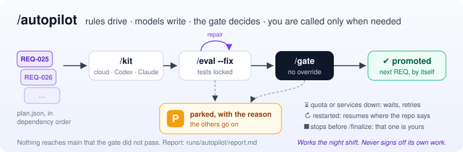

# CLike — Governed AI-Native Delivery for Coding Agents


[](https://www.python.org/)
[](extensions/vscode)
[](LICENSE)
[](CHANGELOG.md)

> **From intent to impact.** CLike turns an idea into reviewed, tested and promotable software
> through a governed lifecycle in which cloud models and local coding agents execute, while
> deterministic evaluation and gates decide.

---

## Abstract

Coding agents (Claude Code, Codex CLI, cloud LLMs) can now produce large amounts of code quickly.
The open problem is no longer *generation* but **governance**: keeping intent, requirements,
implementation, tests and promotion decisions aligned, auditable and safe when much of the work is
performed by autonomous agents.

CLike is an R&D platform that addresses this problem with three ideas:

1. **A structured lifecycle (Harper)** — `IDEA → SPEC → PLAN → KIT → EVAL → GATE → FINALIZE` —
   where every phase produces canonical, reviewable artifacts and each requirement (REQ) advances
   through short, verifiable loops.
2. **Agent-agnostic execution under one contract** — the same phase contract (inputs, expected
   outputs, allowed write roots, validation) is rendered either as a cloud prompt or as an execution
   package for a local agent, so the choice of executor never bypasses governance.
3. **Evidence-based promotion** — a deterministic eval runner produces evidence, and the gate, not a
   model, decides whether a candidate can be promoted.

```text
The developer leads.        CLike governs.
Models and agents execute.  Eval and Gate decide.
```

## Highlights

- **From idea to running solution** — `IDEA → SPEC → PLAN → (KIT → EVAL → GATE)* → FINALIZE`:
  every REQ is implemented, verified in a sandbox and promoted only through a gate; `/finalize`
  delivers the solution configured and started, with a report of everything it did.
- **Release after release** — `/idea --extend` evolves a delivered project: new needs in
  `docs/inputs/vN/` merged into IDEA and SPEC, new REQs typed ADDED / MODIFIED / REMOVED,
  delivered REQs protected by the regression.
- **Any executor, same rules** — cloud models, Claude Code and Codex receive the same context and
  the same contracts; BMAD roles can guide each phase.
- **Governance that cannot be bypassed** — locked acceptance tests, regression of delivered REQs,
  evidence-based gate, 3-way promotion, audit; repairs from the real failures (`/eval --fix`).
- **Drivable by agents** — through MCP, Claude Code and Codex can run a whole project from `/init`
  to `/finalize`, while CLike still governs every step.
- **Local and stack-agnostic** — Podman or Docker, any language and infrastructure.

**[CLike at a glance →](docs/clike-at-a-glance.md)** — the picture of the whole, area by area.

**[The chat (UI) →](docs/chat-ui.md)** — what you see in VS Code: the chat, the cockpit (project, next action, REQs, methodology, last run), the run card and Stop.

## Status

| Version | Date | Milestone |
|---|---|---|
| 1.6.3 | 2026-10 | An `/idea --extend` that keeps its work: every check of a delivered REQ's eval profile can be superseded, a superseded test named without its REQ is completed with the REQ that owns it, a rejected cascade keeps its documents under `runs/extend/rejected/` and leaves nothing behind; the extend commit holds the whole release: documents, lane guides and the release's inputs. See [CHANGELOG](CHANGELOG.md). |
| 1.6.4 | 2026-10 | Script checks with nothing to install: shellcheck and PowerShell are in the eval sandbox by default; a check whose program the sandbox lacks is never sent to a repair, and the advice says how to add it (`/tools add`, `/tools search`); `/autopilot` retries a parked REQ once CLike or the sandbox tools changed. See [CHANGELOG](CHANGELOG.md). |
| 1.6.5 | 2026-10 | Declared changes that hold: a test a release replaces on purpose is recognised in whichever delivered REQ's check runs it, in the output of the common test runners of any language; one the cascade did not name is declared with `/eval <REQ> --supersede` (checked, audited), and the report gives the exact command; a timeout under the parallel load of the regression runs again alone instead of going to a repair; `/kit`, `/eval` and `/gate` no longer overwrite what changed in the plan during their run. See [CHANGELOG](CHANGELOG.md). |
| 1.6.6 | 2026-10 | Promoted when delivered: a REQ is promoted only when its acceptance criteria are delivered (`docs/ACCEPTANCE.json`, the blocking `acceptance::coverage` check, a self review declaring the KIT incomplete blocks too); repository-root deliverables (env examples, `.gitignore`, `ci/SOLUTION_LTC.json`, runbooks) reach the root through `root/`, a staging folder is blocked and `/finalize` brings what was left there; the release's journeys are SPEC use cases and the finalize verifies them one by one; `--supersede` is offered only for a pinned list the REQ extends; a declared `package_json` is installed whatever the LTC's runtime. See [CHANGELOG](CHANGELOG.md). |
| **1.6.7** | 2026-10 | A finalize that runs once: a `/finalize` or `/finalize --verify` sent while the solution verification runs is refused, and the eval sandbox runs one request at a time per eval workspace (no false FAIL from two runs composing the same directory); the finalize asks for a local smoke check that is repeatable on a database that already holds data. See [CHANGELOG](CHANGELOG.md). |

The last five versions; every version and change is in the [CHANGELOG](CHANGELOG.md).

CLike is research software under active development. Interfaces may change between minor versions.

---

## Core concepts

### Harper lifecycle

| Phase | Purpose | Canonical output |
|---|---|---|
| `/idea` | Formalize the idea, scope and constraints | `docs/harper/IDEA.md` |
| `/spec` | Business and technical requirements | `docs/harper/SPEC.md` |
| `/plan` | Requirements (REQ) with acceptance criteria, lanes and dependencies | `docs/harper/PLAN.md`, `plan.json` |
| `/kit <REQ>` | Implement one REQ as a candidate: code, tests, docs, CI profile | `runs/kit/<REQ>/…` |
| `/eval <REQ>` | Run the REQ's checks and collect evidence | eval report |
| `/gate <REQ>` | Decide promotability from the evidence | gate report |
| `/idea --extend` | Next release of a delivered project: new needs from `docs/inputs/vN/` merged into IDEA/SPEC, PLAN delta of REQs typed ADDED / MODIFIED / REMOVED, delivered REQs read-only | IDEA/SPEC/PLAN merged, `docs/harper/EXTEND_*.md` |
| `/finalize` | Bring the promoted solution to running and configured (verified in the sandbox, REQ tests not run again) | `docs/harper/FINALIZE_REPORT.md`, `SOLUTION_EVAL.md`, `scripts/setup_local` / `start_solution_local` |

`/kit → /eval → /gate` is an iterative control loop per REQ, not a one-shot generation step.
Candidates live under `runs/kit/<REQ>/` and are promoted into canonical source roots only after a gate.

### Governance principles

- **Canonical artifacts win.** Methodology companions, skills and agent output are advisory.
- **Executors are interchangeable; contracts are not.** Cloud and local execution share the same
  phase contract and are normalized by the orchestrator.
- **Agents cannot promote.** Local agents write only to the roots allowed by the phase contract and
  never run Git or promotion.
- **The gate is deterministic.** Pass/fail comes from executed checks, not from a model's judgment.
- **The developer is the orchestrator.** No phase advances until its output is reviewed.

### Two agent operating models

- **Developer → CLike → agent.** The developer runs a phase; the orchestrator builds an execution
  package; the extension runs Claude Code or Codex CLI locally; results are normalized and continue
  through eval and gate. Free Q&A and Coding chat modes can run the same way.
- **Agent → CLike.** An external agent operates CLike through MCP, dispatching the same commands a
  developer would type, so it inherits the same governance.

Details: [docs/agent-operating-model.md](docs/agent-operating-model.md).

---

## Architecture

```text
                      trust boundary: loopback only · service token on every call
┌───────────────────────────┐      ┌───────────────────────────────┐      ┌───────────────────────────┐
│ VS CODE EXTENSION         │token │ ORCHESTRATOR (FastAPI)        │token │ MODEL GATEWAY (FastAPI)   │
│ the only workspace writer │─────▶│ Harper domain                 │─────▶│ provider abstraction      │ ──▶ cloud providers
│ • chat UI, slash commands │      │ • phase contracts & packages  │      │ • OpenAI / Anthropic      │
│ • confined file writes    │◀─────│ • execution policy            │◀─────│ • OpenAI-compatible       │
│ • Git (non-destructive)   │      │ • gate & acceptance integrity │      │   (e.g. Ollama, optional) │
│ • local agent actuator    │      │ • RAG API · MCP server        │      │ • embeddings, telemetry   │
│ • operational MCP (opt.)  │      │                               │      │                           │
└───────────────────────────┘      └───────────────────────────────┘      └───────────────────────────┘
              │                          │ evalnet               │
              ▼                          ▼                       ▼
┌───────────────────────────┐      ┌─────────────────────────┐  ┌──────────────┐
│ LOCAL CODING AGENTS       │      │ EVAL SANDBOX            │  │ Qdrant       │
│ Claude Code · Codex CLI   │      │ runs LTC checks;        │  │ vector store │
│ own CLI session; write    │      │ no secrets, non-root,   │  └──────────────┘
│ roots from the contract   │      │ read-only, isolated net │
└───────────────────────────┘      └─────────────────────────┘
```

| Component | Path | Responsibility |
|---|---|---|
| VS Code extension | [`extensions/vscode/`](extensions/vscode) | UI, workspace access, confined writes, local agent execution, Git, RAG collection |
| Orchestrator | [`orchestrator/`](orchestrator) | Harper phase semantics and definitions (`phases/`), typed phase contract, cloud prompt composition, local-agent packages, eval/gate, RAG, MCP |
| Gateway | [`gateway/`](gateway) | Model catalog and routing, provider calls, RAG material and output extraction/validation for Harper runs, embeddings, telemetry |
| Configuration | [`configs/`](configs) | Model catalog (`models.yaml`), routing profiles |
| Runtime | [`docker/`](docker) | Local stack (Podman or Docker Compose) |

Further reading: [architecture](docs/architecture.md) · [Harper workflow](docs/harper-workflow.md) ·
[artifacts](docs/artifacts.md) · [context sources](docs/context-sources.md) · [RAG](docs/rag.md) · [Git and promotion](docs/git-and-promotion.md).

---

## Security model

CLike executes model-generated code and drives agents that write files, so security is part of the design:

- **Authenticated, loopback-only services.** Every endpoint except `/health` requires a service
  token; services fail closed without one, accept only loopback/service `Host` headers and expose
  no CORS.
- **Confinement.** Paths from models, agents or requests are confined to their roots (workspace,
  run directory, telemetry); the extension is the only component that writes the workspace.
- **Trusted, isolated evaluation.** The gate executes the profile stored in the workspace, never one
  supplied by the caller, in a sandbox without credentials or access to the other services; the
  acceptance surface is locked before evaluation and tampering blocks the gate; overrides are audited.
- **Least privilege at runtime.** Services run as a non-root user; the CLike repository is mounted
  read-only.
- **Non-destructive Git.** Only the files of a phase are committed; no branch is rewritten; commit,
  push, merge and PR automation are opt-in.

See [SECURITY.md](SECURITY.md) for the threat model, current limitations and how to report a vulnerability.

---

## Install

Requirements: VS Code 1.85+, Podman 5 with `podman-compose` (or Docker Compose v2) and a container
VM with at least 4 GB, provider API keys for cloud models, optionally the Claude Code or Codex CLI.

```bash
cp .env.example .env                      # provider keys + CLIKE_API_TOKEN=$(openssl rand -hex 32)
cp docker/.env.example docker/.env        # CLIKE_PROJECTS_DIR = host folder containing your projects
cd docker && podman-compose up -d --build # services on 127.0.0.1, wait until (healthy)
code --install-extension ../extensions/vscode/clike-1.6.7.vsix
```

In VS Code: **CLike: Set Service Token** (the `CLIKE_API_TOKEN` value). Full guide, local agents
and the MCP setup for Claude Code / Codex: **[docs/INSTALL.md](docs/INSTALL.md)**.

## Get started

Open a project under `CLIKE_PROJECTS_DIR`, run **CLike: Chat (Q&A / Harper / Coding)**, Harper mode:

```text
/init → /idea → /spec → /plan → ( /kit REQ-xxx → /eval REQ-xxx --fix → /gate REQ-xxx )* → /finalize

next release:  /idea --extend → ( /kit → /eval --fix → /gate )* for the new REQs → /finalize
```

`/autopilot` runs the `( /kit → /eval --fix → /gate )*` part unattended — from the chat, MCP or
`scripts/clike-autopilot.sh` — parks a REQ that needs you and resumes where it was after an
interruption ([commands](docs/commands.md#autopilot)).



With execution = agent the chat is a continuing conversation with Claude Code or Codex
(`/agent-model`, `/agent-session`), and Claude Code / Codex can drive CLike through MCP.
Walkthrough, options and troubleshooting: **[docs/GET_STARTED.md](docs/GET_STARTED.md)**.

### Telemetry

Every phase run (cloud or local agent) is recorded per project: model, tokens (cached ones
included), duration and cost. Open **http://127.0.0.1:8000/v1/metrics/harper/ui** and log in with
`CLIKE_API_TOKEN`. Local-agent cost is the API-equivalent cost. Details:
[telemetry portal](docs/CLike_Harper_Telemetry_Portal.md).

---

## Extensibility

- **Capabilities** — project-local skills, packs and design profiles (`.clike/`) that PLAN selects
  per REQ and KIT/EVAL/GATE enforce. → [docs/CAPABILITIES.md](docs/CAPABILITIES.md)
- **Methodology profiles** — optional, advisory enrichment of phases (e.g. BMAD roles) without a
  runtime dependency and without overriding Harper governance. → [docs/integrations/bmad](docs/integrations/bmad/README.md)
- **MCP** — a read-only informational server in the orchestrator and an opt-in operational server in
  the extension, both token-protected. → [docs/mcp.md](docs/mcp.md)
- **Models** — declarative catalog and routing in `configs/models.yaml`. → [setup and runtime](docs/setup-and-runtime.md)

---

## Engineering practice

| Practice | How |
|---|---|
| Reproducible builds | Python 3.12, per-service `pyproject.toml` + `uv.lock`; `npm ci` with lockfile |
| Behavioural safety net | Golden snapshots of the phase boundary (orchestrator → gateway → provider) |
| Security regression suites | Authentication, confinement, Git safety (tests on real repositories) |
| Static analysis | ESLint with a frozen baseline: existing debt can only shrink |
| Repository hygiene | Pre-commit and CI check: no telemetry, secrets or private notes in the public repo |
| Continuous integration | GitHub Actions: hygiene, orchestrator, gateway, extension (Linux, Windows) |

Developer guide: [docs/development.md](docs/development.md).

---

## Research context

CLike combines three lines of work and investigates how to make them governable in practice:

- **Harper-style iterative generation** — idea → spec → plan → kit in short, verifiable loops
  ([Harper Reed — LLM codegen workflow](https://harper.blog/posts/)).
- **Vibe coding** — intent- and outcome-level development with cognitive offloading to AI
  ([Gartner](https://www.gartner.com/document-reader/document/6494971?ref=pubsite)).
- **AI-native software engineering** — agentic workflows with human-in-the-loop governance, grounding
  and automated validation ([Gartner](https://www.gartner.com/document-reader/document/6076795?ref=pubsite)).

Open research questions the project works on:

1. How to keep acceptance criteria **independent** from the implementation produced by the same agent.
2. How to bound **autonomous KIT ⇄ EVAL repair loops** (iterations, cost, escalation) without losing control.
3. How to make the same governed lifecycle usable **from inside native coding agents** (skills, MCP, CI gates).
4. How to measure delivery outcomes (lead time, first-pass gate rate, cost per requirement) rather than code volume.

## Roadmap

| Horizon | Focus |
|---|---|
| **M2** | Gate in an isolated sandbox, acceptance lock with tamper detection and audited overrides (done); provider and functional fixes |
| **M3** | Typed, versioned phase contract; one definition per phase rendered for cloud and agents |
| **Next** | Native agent chat with streaming, inline approvals and runtime policy enforcement · Harper usable from Claude Code / Codex (skills, MCP, CLI) and as a CI gate · autonomous KIT ⇄ EVAL loops · parallel REQs on Git worktrees · taking over projects not built with CLike inside `/idea --extend` · traceability and delivery metrics |

---

## Documentation

| Topic | Document |
|---|---|
| Overview and reading order | [CLike at a glance](docs/clike-at-a-glance.md), [docs/README.md](docs/README.md) |
| The chat UI (cockpit, run card) | [docs/chat-ui.md](docs/chat-ui.md) |
| Getting operational | [HOWTO](docs/HOWTO.md), [Harper run walkthrough](docs/Clike%20HARPER%20RUN.md), [project via MCP](docs/howto-mcp-project.md), [/init → /finalize with BMAD from Claude Code](docs/howto-mcp-bmad-claude.md) |
| Concepts | [architecture](docs/architecture.md), [Harper workflow](docs/harper-workflow.md), [agent operating model](docs/agent-operating-model.md), [artifacts](docs/artifacts.md) |
| Reference | [commands](docs/commands.md), [API](docs/api-reference.md), [MCP](docs/mcp.md), [capabilities](docs/CAPABILITIES.md) |
| Operations | [setup and runtime](docs/setup-and-runtime.md), [Git and promotion](docs/git-and-promotion.md), [telemetry portal](docs/CLike_Harper_Telemetry_Portal.md) |
| Development | [developer guide](docs/development.md), [CHANGELOG](CHANGELOG.md), [SECURITY](SECURITY.md) |
| Community | [CONTRIBUTING](CONTRIBUTING.md), [Code of Conduct](CODE_OF_CONDUCT.md), [SUPPORT](SUPPORT.md), [Discussions](https://github.com/authenticfake/clike/discussions) |

## Contributing

Issues, ideas and pull requests are welcome: start from [CONTRIBUTING.md](CONTRIBUTING.md).
Questions go to [Discussions](https://github.com/authenticfake/clike/discussions), security
problems are reported privately as described in [SECURITY.md](SECURITY.md).

## License

Apache License 2.0 — see [LICENSE](LICENSE) and [NOTICE](NOTICE).

---

**CLike on, code on.**
