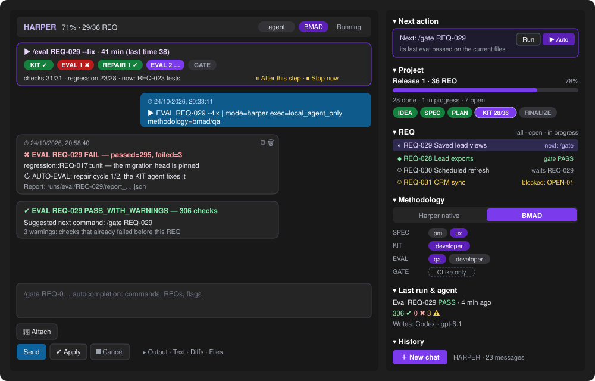

# The CLike chat (UI)

What the developer sees in VS Code. The chat is the front of CLike: every command goes through it
(or through MCP from Claude Code / Codex), and it shows what CLike does, step by step. The UI never
decides anything: the phases, the eval and the gate are CLike's (orchestrator, eval sandbox,
gateway); the chat starts them, shows them, and lets you stop them.

## What it is

- **Chat on the left**: your commands and messages, CLike's answers as cards (one card for what a
  command says while it runs, with the time of each message). Each bubble has **⧉ copy** and
  **🗑 delete**.
- **Cockpit on the right** (`clike.chat.theme: cockpit`, the default): the state of the project read
  from the repository (plan.json, the Harper documents, the eval and gate reports), not from a
  model.
- **Run card** above the chat and the **VS Code status bar**: the command in flight.

Beside the editor (narrow) the cockpit becomes one column with the side panel in a drawer (☰).
The other layouts (`classic`, `pro`, `studio`, `paper`) have the same features.

## What it does

| Area | Shows | You can |
|---|---|---|
| **Mode & settings** | mode (Free · Coding · Harper), execution (cloud / agent), cloud model, local agent and its model, history scope | change any of them; the agent models listed are the ones the CLI accepts |
| **Methodology** | Harper native or BMAD, with the role per phase where BMAD allows more than one | choose it; it is added to the commands the cockpit proposes |
| **Project** | release, REQs done / in progress / open, phases IDEA → FINALIZE; 100% only when every REQ is done and the last `/finalize` passed (a failed one stays the next action, with its reason) | — |
| **Next action** | the next command by the autopilot's rules (phase order, dependencies, last eval), with alternatives | **Run** it, or **▶ Autopilot** for every REQ unattended |
| **REQ** | each REQ with what it waits for: a dependency, its next step, `gate PASS`, or **blocked** when the plan says it waits for your answers (`kit_ready: false`, the questions in the tooltip) | click a REQ to put its next command in the prompt |
| **Last run & agent** | the last eval or gate (status, failed checks, warnings) and who writes (cloud model or agent) | — |
| **History** | earlier conversations of the mode | **＋ New chat**; reopen one with a click |

**Run card** (every layout): the real steps of the command (KIT, EVAL 1, REPAIR 1, EVAL 2, GATE…)
with their outcome, the cycle of a `--fix` loop, time and an estimate from the last time, the
eval's checks as they run in the sandbox (`13/31 · now: test:e2e`, then the regression of the
promoted REQs `23/28`), what the agent is doing, the cost. **⏸ After this step** lets the current
step finish (its report is kept) and starts nothing new; **⏹ Stop now** (or Esc) first says what
stopping loses (a running eval leaves no report, files an agent wrote stay uncommitted), then stops.

**Autocompletion**: type `/` — commands, then the REQs that fit, flags and values; an invalid
command shows the parser's error with its fix before you send.

## Settings that change the UI

VS Code settings (`Ctrl/Cmd+,`, search `clike`), or `settings.json`:

| Setting | Default | What it changes |
|---|---|---|
| `clike.chat.theme` | `cockpit` | the layout: `cockpit` (chat + project side panel), `classic`, `pro`, `studio`, `paper`. Also switchable from the **Layout** selector in the chat; every layout has the same features |
| `clike.execution.defaultPreference` | `local_agent_only` | the execution shown and used at start (cloud or local agent); the **Mode & settings** area changes it for the session |
| `clike.localAgent.preferredExecutor` | `gpt_codex` | the local agent selected at start |
| `clike.chat.maxInMemoryMessages` | `50` | how many messages the chat keeps on screen (older ones stay in the history) |
| `clike.chat.persistDir` | `.clike/sessions` | where the conversations of the **History** are saved |
| `clike.agentChat.approvals` | `ask` | in Coding mode, whether the chat asks before each edit or command of the local agent |

After a successful `/finalize` the project's `README.md` opens rendered (reading mode), as the
gate opens its promotion report.

## How it relates to CLike

- The cockpit **reads**; CLike **decides**. The next action follows the same rules as `/autopilot`
  (`autopilot.js`); KIT readiness comes from `plan.json` (`plan-readiness.js`); eval and gate states
  from the saved reports.
- The run card's eval progress comes from the sandbox (`GET /v1/eval/progress`): it is shown, never
  used for a verdict.
- Stop and Cancel reach the running phase, the eval and the local agent (see
  [GET_STARTED](GET_STARTED.md) — *Talking to the agent directly*).

Commands: [commands.md](commands.md). The process: [harper-workflow.md](harper-workflow.md). The
whole picture: [clike-at-a-glance.md](clike-at-a-glance.md).
