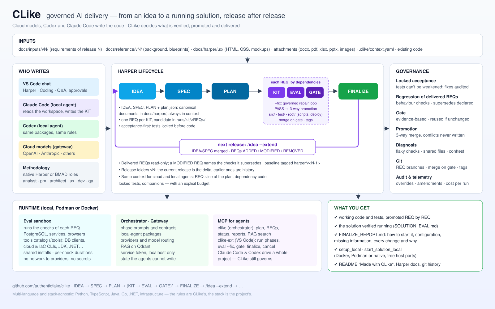

# CLike at a glance



CLike turns an idea into a running, documented solution — and keeps evolving it release after
release — while AI does the writing and CLike decides what is verified, promoted and delivered.
This page walks through the picture area by area, with links to the details.

## Inputs

What a project starts from, read by the phases as context (never as instructions):

- **`docs/inputs/vN/`** — the requirements of release N (docx, pdf, xlsx, pptx, md…). The current
  release is the delta; earlier releases and unversioned inputs are history.
- **`docs/reference/vN/`** — background: blueprints, provider catalogs, documentation of an
  existing system.
- **`docs/harper/ux/`** — what the UI must look like: HTML prototypes, CSS, mockups, UX notes.
- **Attachments** of a command, **`.clike/context.yaml`** (which files each phase reads, with which
  role), and the **existing code** of the project.

Details: [context-sources.md](context-sources.md), [commands.md](commands.md).

## Who writes

- **VS Code chat** — three modes: Harper (the lifecycle), Coding, Q&A; with approvals for agent
  actions.
- **Claude Code** and **Codex** as local agents — they read the workspace and write the KIT
  candidate, under the same packages and write rules.
- **Cloud models** through the gateway (OpenAI, Anthropic, others) — they receive the same context
  a local agent would read, within an explicit budget.
- **Methodology** — native Harper, or BMAD roles per phase (analyst, pm, ux, architect, developer,
  qa, tech-writer) as guidance; CLike's contracts always win.

Details: [local-agents.md](local-agents.md), [integrations/bmad/COMMANDS.md](integrations/bmad/COMMANDS.md).

## Harper lifecycle

```text
IDEA → SPEC → PLAN → ( KIT → EVAL → GATE )* per REQ → FINALIZE
```

- **IDEA, SPEC, PLAN** — the canonical documents in `docs/harper/` (with `plan.json`, the REQs),
  always in context.
- **KIT** — one REQ at a time, as a candidate in `runs/kit/<REQ>/`: code (`src/`), tests (`test/`),
  eval profile (`ci/`), docs, and repository-root files (`root/`: scripts, deploy). With
  acceptance-first the tests are written and locked before the code.
- **EVAL** — the REQ's checks in the sandbox, plus the regression of the delivered REQs;
  `--fix` runs a governed repair loop from the real failures.
- **GATE** — the decision from the evidence; on PASS the candidate is promoted with a 3-way merge
  and, if configured, merged into the default branch.
- **FINALIZE** — the whole solution installed, configured, started and smoke-checked; the
  developer gets the report and the scripts to run it.

Details: [harper-workflow.md](harper-workflow.md), [auto-eval.md](auto-eval.md),
[git-and-promotion.md](git-and-promotion.md).

## The next release

`/idea --extend` evolves a delivered project: the new release (`docs/inputs/vN/`) is merged into
IDEA, SPEC and TECH_CONSTRAINTS, and the PLAN receives new REQs typed **ADDED**, **MODIFIED**
(naming the checks of a delivered REQ it supersedes) or **REMOVED**. Delivered REQs stay
read-only, the baseline is tagged `harper/v<N-1>`, and an EXTEND report carries CLike's own
verification. Then the same loop runs on the new REQs.

Details: [commands.md](commands.md) (`/idea --extend`), [architecture/ADOPT_AND_IDEA_EXTEND.md](architecture/ADOPT_AND_IDEA_EXTEND.md).

## Governance

- **Locked acceptance** — tests cannot be weakened; a test fix is audited and marked for review.
- **Regression of delivered REQs** — their behaviour checks run with every candidate; a declared
  change supersedes only the checks it names.
- **Gate** — evidence-based; when nothing changed since a passing eval, its verdict is reused.
- **Promotion** — 3-way merge per file; a conflict is never written, it is reported.
- **Diagnosis** — flaky checks, shared files a candidate replaced, a shared conftest dropped.
- **Git** — REQ branches, merge on gate, tags per phase and release.
- **Audit and telemetry** — overrides, amendments, cost per run.

Details: [auto-eval.md](auto-eval.md), [../SECURITY.md](../SECURITY.md).

## Runtime

Everything runs locally with Podman or Docker:

- **Eval sandbox** — runs the checks with PostgreSQL, services and browsers; installs native tools
  from a catalog on request (`/tools`); shares installs; no network to providers, no secrets.
- **Orchestrator and gateway** — phase prompts and contracts, local-agent packages, providers and
  model routing, RAG on Qdrant; service token, localhost only, state the agents cannot write.
- **Memory panel** — the project's RAG memory and CLike's own guide, queried in any language next
  to the chat; the memory follows the KITs (files removed from a KIT leave it).
- **MCP for agents** — `clike` (orchestrator) reads plan, REQs, status, reports, RAG; `clike-ext`
  (VS Code) runs the phases, `eval --fix`, gate, finalize. Claude Code and Codex can drive a whole
  project, and CLike still governs every step.

Details: [setup-and-runtime.md](setup-and-runtime.md), [mcp.md](mcp.md),
[howto-mcp-project.md](howto-mcp-project.md), [howto-mcp-bmad-claude.md](howto-mcp-bmad-claude.md).

## What you get

- Working code and tests, promoted REQ by REQ.
- The solution verified running (`docs/harper/SOLUTION_EVAL.md`).
- `docs/harper/FINALIZE_REPORT.md` — how to start and see it, every configuration variable, the
  information only you can give, every change and why.
- `scripts/setup_local` and `scripts/start_solution_local` — Docker, Podman or native, with free
  host ports.
- A README marked *Made with CLike*, the Harper documents, a readable git history.

CLike is multi-language and stack-agnostic: Python, TypeScript, Java, Go, .NET, infrastructure —
the rules are CLike's, the stack is the project's.
